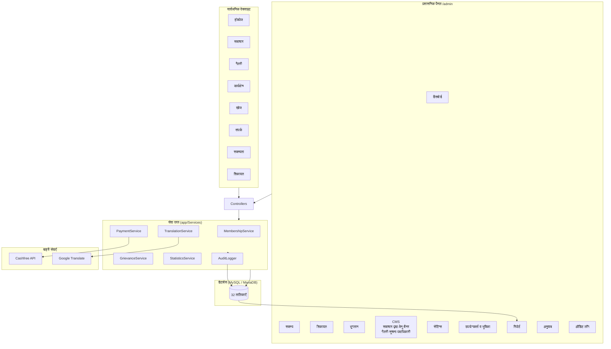
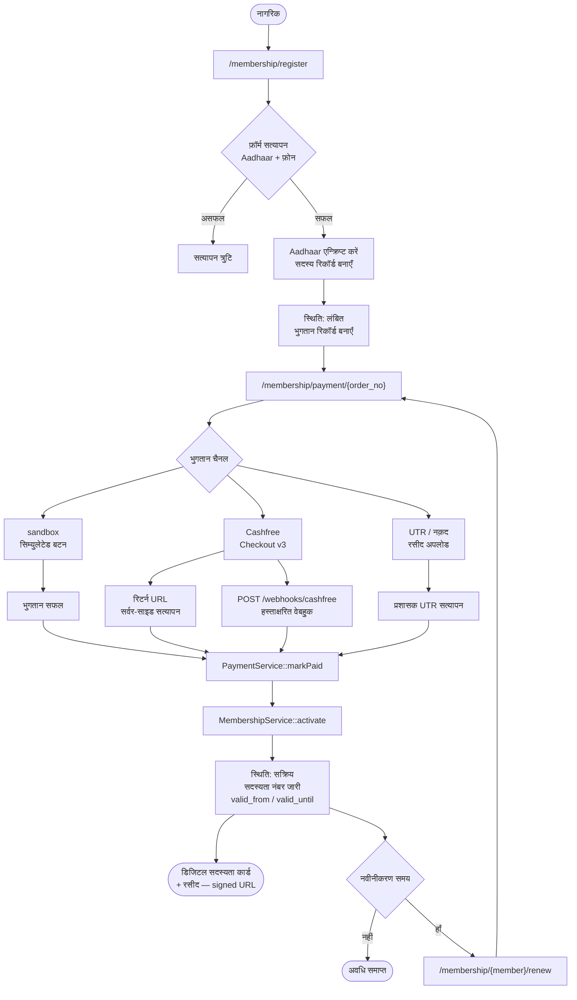
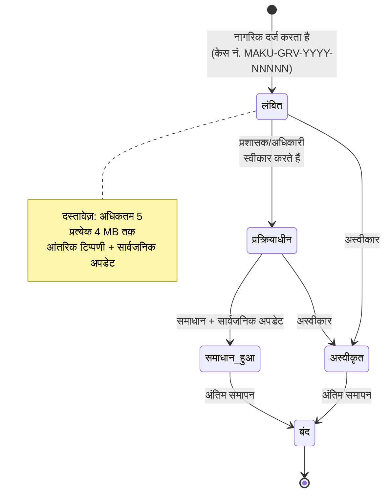
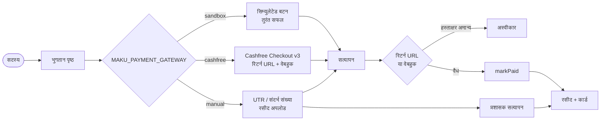
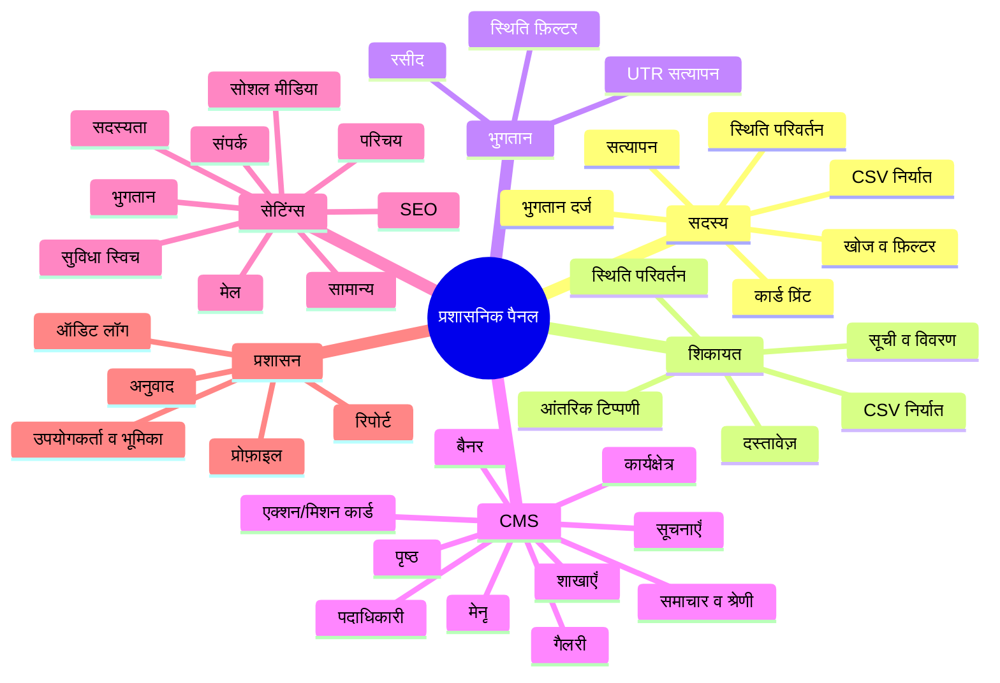
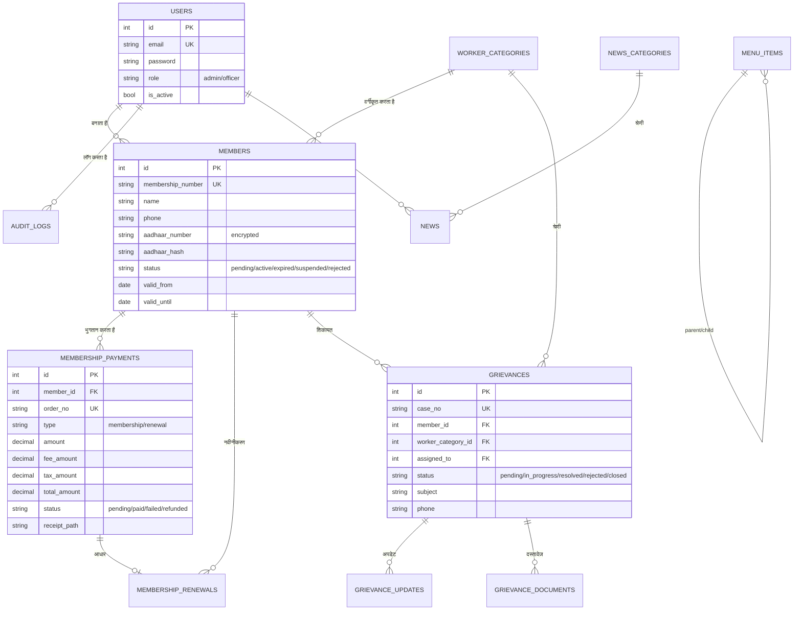

# MAKU — मिर्जापुर असंगठित कामगार यूनियन

[](https://www.php.net/)
[](https://laravel.com/)
[](https://www.mysql.com/)
[](LICENSE)
[](https://phpunit.de)

> **एक-पंक्ति:** मिर्जापुर असंगठित कामगार यूनियन की आधिकारिक हिन्दी वेबसाइट एवं प्रशासन पैनल — सदस्यता, ऑनलाइन भुगतान, शिकायत प्रबंधन, CMS और पूर्ण ऑडिट लॉग।

---

## 📝 GitHub विवरण

**रिपॉज़िटरी "About" के लिए छोटा विवरण (एक पंक्ति):**

```
मिर्जापुर असंगठित कामगार यूनियन (MAKU) — Laravel 13 आधारित हिन्दी वेबसाइट एवं प्रशासन पैनल: सदस्यता पंजीकरण, ऑनलाइन भुगतान, शिकायत प्रबंधन, CMS, सेटिंग्स और ऑडिट लॉग।
```

**विस्तृत विवरण:**

```
MAKU — मिर्जापुर असंगठित कामगार यूनियन (संबद्ध: भारतीय मजदूर संघ, BMS) का आधिकारित डिजिटल प्लेटफ़ॉर्म।
पूर्णतः हिन्दी इंटरफ़ेस वाला यह Laravel 13 अनुप्रयोग दो भागों में बँटा है — (1) सार्वजनिक वेबसाइट: होमपेज, समाचार, गैलरी,
कार्यक्षेत्र, सदस्यता पंजीकरण व रसीद, डिजिटल सदस्यता कार्ड, नवीनीकरण, शिकायत दर्ज/ट्रैकिंग और संपर्क; और
(2) प्रशासनिक पैनल: सदस्य, शिकायत, भुगतान, CMS (समाचार/पृष्ठ/मेनू/बैनर/गैलरी), वेबसाइट सेटिंग्स, उपयोगकर्ता व
भूमिकाएँ, CSV रिपोर्ट, अनुवाद समीक्षा और पूर्ण ऑडिट लॉग। भुगतान Cashfree Checkout v3, UTR मैन्युअल और
sandbox तीनों चैनलों से; सदस्यता कार्ड/रसीद signed URL से सुरक्षित; आधार-एन्क्रिप्टेड Aadhaar, भूमिका-आधारित
पहुँच और पूर्ण परिवर्तन-लेखन ऑडिट।
```

---

## तकनीकी ढाँचा (Tech Stack)

| परत | प्रौद्योगिकी |
| --- | --- |
| बैकएंड | PHP 8.4, Laravel 13 |
| फ्रंटएंड | Blade, Bootstrap 5, Vanilla JS (कोई SPA फ़्रेमवर्क नहीं) |
| डेटाबेस | MySQL 8 / MariaDB 10.4 (विकास हेतु SQLite भी समर्थित) |
| भुगतान | Cashfree Checkout v3 + webhook, UTR मैन्युअल, sandbox |
| अनुवाद | Google Translate API (वैकल्पिक) |
| फ़ाइल भंडारण | Laravel public disk (`MAKU_UPLOAD_DISK`) |
| कतार | Database queue |
| परीक्षण | PHPUnit 12 (14 टेस्ट) |

---

## मुख्य विशेषताएँ

### सार्वजनिक वेबसाइट

- **होमपेज** — बैनर स्लाइडर, सूचना पट्टी (auto-rotating), कार्यक्षेत्र, मिशन कार्ड, एक्शन कार्ड, समाचार, गैलरी एवं संपर्क ब्लॉक
- **पृष्ठ प्रबंधन** — परिचय, उद्देश्य, संविधान, इतिहास, पदाधिकारी आदि static पृष्ठ (`/page/{slug}`)
- **गैलरी** — श्रेणीवार फ़िल्टर + lightbox (keyboard navigation सहित)
- **कार्यक्षेत्र (श्रेणी)** — श्रेणी सूची एवं श्रेणी-वार सदस्यता जानकारी
- **समाचार** — सूची, श्रेणी फ़िल्टर, पेजिनेशन एवं विस्तृत पृष्ठ
- **साइट खोज** — समाचार/पृष्ठ/सदस्यों में एकीकृत खोज
- **संपर्क** — फ़ॉर्म + प्रशासक इनबॉक्स में संदेश
- **सदस्यता** — पंजीकरण, सदस्यता नंबर + फ़ोन से लुकअप, "सदस्यता भूल गए" पुनःखोज, डिजिटल कार्ड, नवीनीकरण
- **भुगतान** — बैंक/UPI/QR, Cashfree, UTR जमा, रसीद (signed URL)
- **शिकायत** — बिना लॉगिन दर्ज करना, केस नंबर + मोबाइल से ट्रैकिंग, दस्तावेज़ अपलोड

### प्रशासनिक पैनल (`/admin`)

| मॉड्यूल | क्षमताएँ |
| --- | --- |
| **डैशबोर्ड** | सदस्य/शिकायत/भुगतान/संदेश आँकड़े, हाल की गतिविधि |
| **सदस्य** | खोज, फ़िल्टर, सत्यापन, स्थिति परिवर्तन, भुगतान दर्ज, कार्ड प्रिंट, CSV निर्यात |
| **शिकायत** | सूची, विवरण, स्थिति परिवर्तन, आंतरिक टिप्पणी, दस्तावेज़ अपलोड/डाउनलोड, CSV निर्यात |
| **भुगतान** | सभी भुगतान, स्थिति फ़िल्टर, UTR/कैश सत्यापन |
| **समाचार** | समाचार + श्रेणी (CRUD) |
| **पृष्ठ** | static पृष्ठ CRUD |
| **मेनू** | nested मेनू (parent/child, sort order) |
| **बैनर** | होमपेज बैनर CRUD |
| **एक्शन/मिशन कार्ड** | होमपेज कार्ड CRUD |
| **गैलरी** | चित्र अपलोड + श्रेणी |
| **सूचनाएँ** | सूचना बैनर |
| **पदाधिकारी** | टीम सदस्य (पद, फ़ोटो, सोशल) |
| **शाखाएँ** | शाखा जानकारी + नक़्शा/लिंक |
| **कार्यक्षेत्र** | श्रेणी CRUD |
| **संपर्क संदेश** | इनबॉक्स, विवरण, हटाना |
| **सेटिंग्स** | 9 समूह: `general`, `contact`, `social`, `payment`, `membership`, `about`, `mail`, `seo`, `flags` |
| **उपयोगकर्ता** | प्रशासक/अधिकारी, भूमिका, सक्रिय-स्थिति, पासवर्ड |
| **प्रोफ़ाइल** | अपना नाम, फ़ोन, पासवर्ड बदलना |
| **रिपोर्ट** | सदस्य/शिकायत/भुगतान CSV निर्यात |
| **अनुवाद** | अनुवाद समीक्षा, किल-स्विच, उपयोग सांख्यिकी |
| **ऑडिट लॉग** | लॉगिन/लॉगआउट, सार्वजनिक फ़ॉर्म, प्रशासनिक बदलाव + CSV निर्यात |

### सुविधा स्विच (Feature Flags)

पैनल से टॉगल किए जा सकने वाले स्विच: `membership_open`, `notice_enabled`, `gallery_home_enabled`, `translate_enabled`, `translate_kill_switch`।

---

## 🔄 फ़्लोचार्ट (Flow Diagrams)

### 1. सिस्टम आर्किटेक्चर



### 2. सदस्यता पंजीकरण एवं भुगतान प्रवाह



### 3. शिकायत जीवन-चक्र (Lifecycle)



### 4. भुगतान चैनल चयन



### 5. प्रशासनिक पैनल मॉड्यूल मैप



### 6. मुख्य डेटा संबंध (ER)



---

## स्थापना

### आवश्यकताएँ

- PHP 8.4+ (`pdo_mysql`, `mbstring`, `openssl`, `fileinfo` एक्सटेंशन)
- Composer
- MySQL 8 या MariaDB 10.4+ (विकास हेतु SQLite भी समर्थित)
- Node.js एवं npm (केवल फ्रंटएंड बिल्ड हेतु; डिफ़ॉल्ट CSS/JS सीधे `public/assets` में उपलब्ध हैं)

### चरण

```bash
composer install
cp .env.example .env
php artisan key:generate
```

`.env` में डेटाबेस विवरण भरें:

```env
DB_CONNECTION=mysql
DB_HOST=127.0.0.1
DB_PORT=3306
DB_DATABASE=maku_union
DB_USERNAME=root
DB_PASSWORD=
```

> **सुरक्षा नोट:** `root`/खाली पासवर्ड केवल स्थानीय विकास हेतु। उत्पादन में अलग `maku_user` खाता बनाएँ और `.env` को Git से बाहर रखें।

प्रशासक खाता हेतु `ADMIN_EMAIL` एवं `ADMIN_PASSWORD` भरें:

```env
ADMIN_NAME="मुख्य प्रशासक"
ADMIN_EMAIL=admin@example.org
ADMIN_PASSWORD=कम-से-कम-8-अक्षर
```

फिर:

```bash
php artisan migrate --seed     # स्कीमा + हिन्दी प्रारंभिक सामग्री
php artisan storage:link      # अपलोड सार्वजनिक डिस्क से जोड़ें
php artisan serve
```

- वेबसाइट: `http://127.0.0.1:8000`
- प्रशासन पैनल: `http://127.0.0.1:8000/admin`

### SQLite से MySQL में स्थानांतरण

```bash
# 1. MySQL पर लक्ष्य डेटाबेस बनाएँ
mysql -u root -e "CREATE DATABASE maku_union CHARACTER SET utf8mb4 COLLATE utf8mb4_unicode_ci;"

# 2. .env में DB_CONNECTION=mysql करें
# 3. स्कीमा बनाएँ
php artisan migrate --force
```

डेटा स्थानांतरण हेतु SQLite और MySQL दोनों कनेक्शन बनाकर `DB::connection('sqlite')` से पंक्तियाँ पढ़ें एवं `DB::connection('mysql')` में डालें — `migrations` तालिका को छोड़ें (वह `artisan migrate` से पहले से भरी होती है)।

### डेमो डेटा

गैर-उत्पादन परिवेश में `SampleDataSeeder` स्वतः चलता है और सदस्य, भुगतान, शिकायतें, समाचार, सूचनाएँ, पदाधिकारी, शाखाएँ, गैलरी चित्र, संपर्क संदेश, अनुवाद एवं ऑडिट लॉग भरता है (प्लेसहोल्डर SVG सहित)। ताज़ा डेमो डेटा हेतु:

```bash
php artisan migrate:fresh --seed --force
```

सार्वजनिक पृष्ठों पर प्रदर्शित डेमो सामग्री पैनल से संपादित या हटाई जा सकती है। सीडर उत्पादन में नहीं चलता और यदि सदस्य पहले से मौजूद हों तो छोड़ दिया जाता है।

---

## पर्यावरण चर

| चर | विवरण | डिफ़ॉल्ट |
| --- | --- | --- |
| `DB_*` | डेटाबेस कनेक्शन | `mysql` / `maku_union` |
| `MAKU_MEMBERSHIP_FEE` | सदस्यता शुल्क (₹) | `100` |
| `MAKU_RENEWAL_FEE` | नवीनीकरण शुल्क (₹) | `100` |
| `MAKU_PAYMENT_GATEWAY` | `sandbox`, `cashfree` या `manual` | `sandbox` |
| `MAKU_UPLOAD_DISK` | अपलोड डिस्क | `public` |
| `MAKU_UPLOAD_MAX_KB` | अपलोड आकार सीमा (KB) | `4096` |
| `CASHFREE_APP_ID` / `CASHFREE_SECRET_KEY` | Cashfree क्रेडेंशियल | — |
| `CASHFREE_ENV` | `sandbox` या `production` | `sandbox` |
| `CASHFREE_API_VERSION` | Cashfree API संस्करण | `2023-08-01` |
| `MAKU_GATEWAY_FEE_PERCENT` | गेटवे फ़ीस % | `2` |
| `MAKU_GATEWAY_GST_PERCENT` | GST % | `18` |
| `GOOGLE_TRANSLATE_ENABLED` | मशीन अनुवाद सक्षम करें | `false` |
| `GOOGLE_TRANSLATE_API_KEY` | Google Translate API कुंजी | — |
| `GOOGLE_TRANSLATE_MONTHLY_LIMIT` | मासिक अक्षर सीमा | `500` |
| `APP_TIMEZONE` | समय क्षेत्र | `Asia/Kolkata` |
| `APP_LOCALE` | डिफ़ॉल्ट भाषा | `hi` |

शुल्क एवं कुछ सेटिंग्स पैनल से भी बदली जा सकती हैं; पैनल मान `.env` डिफ़ॉल्ट पर प्राथमिकता रखते हैं।

---

## भुगतान

- **sandbox** (डिफ़ॉल्ट, विकास हेतु): भुगतान पृष्ठ पर सिम्युलेटेड भुगतान बटन; तुरंत सफलता एवं रसीद।
- **cashfree**: Cashfree Checkout v3 + रिटर्न URL पर सर्वर-साइड सत्यापन + `POST /webhooks/cashfree` हस्ताक्षरित वेबहुक। लाइव भुगतान के लिए `MAKU_PAYMENT_GATEWAY=cashfree` और `CASHFREE_ENV=production` सेट करें।
- **manual**: सदस्य UTR/संदर्भ संख्या जमा करता है; प्रशासक भुगतान सत्यापित करता है।
- सभी विकल्पों में बैंक/UPI/QR विवरण एवं UTR फ़ॉलबैक उपलब्ध रहता है (सेटिंग्स से नियंत्रित)।

रसीद, सदस्यता कार्ड एवं भुगतान पृष्ठ अस्थायी हस्ताक्षरित (signed) URL से सुरक्षित हैं।

## शिकायत प्रक्रिया

केस नंबर प्रारूप: `MAKU-GRV-YYYY-NNNNN` (उदाहरण `MAKU-GRV-2026-00001`)। नागरिक बिना लॉगिन के शिकायत दर्ज कर सकता है और केस नंबर + पंजीकृत मोबाइल से स्थिति देख सकता है। अधिकतम 5 दस्तावेज़ (प्रत्येक 4 MB तक)।

## अनुवाद

हिन्दी मूल भाषा है। अंग्रेज़ी सामग्री हेतु वैकल्पिक Google Translate एकीकरण उपलब्ध है; कुंजी न होने या कोटा समाप्त होने पर मूल पाठ दिखता है। अनुवाद पैनल से समीक्षित चिह्नित किए जा सकते हैं और आपातकालीन kill switch उपलब्ध है।

---

## परीक्षण

```bash
php artisan test            # सभी टेस्ट
php artisan test --filter=PaymentFlowTest
```

वर्तमान स्थिति: **14 टेस्ट / 59 assertions — पास** (`PaymentFlowTest`, `SettingManagementTest`, 2× `ExampleTest`)।

डिफ़ॉल्ट रूप से परीक्षण `phpunit.xml` में SQLite in-memory डेटाबेस का उपयोग करते हैं (तेज़ एवं अलग-थलग)। MySQL पर चलाने हेतु `phpunit.xml` में `DB_CONNECTION` बदलें।

---

## निर्देशिका संरचना

```
app/
├── Enums/                     MemberStatus, PaymentStatus, GrievanceStatus, Role
├── Http/Controllers/          सार्वजनिक + Admin controllers
│   └── Admin/                 24 प्रशासनिक controller
├── Http/Requests/             FormRequest सत्यापण
├── Models/                    23 Eloquent मॉडल (PHP attributes से fillable)
├── Services/                  Membership, Payment, Grievance, Translation, Statistics, AuditLogger
├── Support/helpers.php        व्यू हेल्पर (setting, inr, hindi_date आदि)
database/
├── migrations/                11 माइग्रेशन
└── seeders/                   SampleDataSeeder (हिन्दी प्रारंभिक सामग्री)
resources/views/
├── admin/                     21 प्रशासनिक व्यू
├── membership/                register, lookup, forgot, card, payment, receipt, renew
├── grievances/                create, track, show
├── news/ categories/ pages/   सार्वजनिक व्यू
├── layouts/                   public.blade.php, admin.blade.php
└── partials/                  flash, errors, lightbox, notice-slider, page-hero
routes/web.php                 108 मार्ग (32 सार्वजनिक + 76 प्रशासनिक)
public/assets/                 CSS, JS (app.js, admin.js) एवं चित्र
```

---

## सुरक्षा

- सभी फ़ॉर्म CSRF-सुरक्षित; संवेदनशील GET मार्ग signed URL से सुरक्षित
- प्रशासनिक मार्ग `auth` + सक्रिय-उपयोगकर्ता middleware के अंतर्गत
- भूमिका-आधारित पहुँच (प्रशासक/अधिकारी); अंतिम प्रशासक खाता हटाया नहीं जा सकता
- Aadhaar `encrypted` cast (Laravel एन्क्रिप्टेड कास्ट) + अलग `aadhaar_hash`; सार्वजनिक पृष्ठों पर मोबाइल नंबर masked
- प्रशासनिक गतिविधियाँ ऑडिट लॉग में दर्ज
- अपलोड सत्यापन (MIME प्रकार एवं आकार), सार्वजनिक डिस्क पर संग्रहित
- Cashfree वेबहुक हस्ताक्षर सत्यापन

---

## ✅ पूर्ण कार्य (Completed)

### सार्वजनिक वेबसाइट

- [x] होमपेज — बैनर, सूचना पट्टी, कार्यक्षेत्र, मिशन/एक्शन कार्ड, समाचार, गैलरी, संपर्क
- [x] static पृष्ठ प्रबंधन (`/page/{slug}`)
- [x] गैलरी + lightbox
- [x] कार्यक्षेत्र (श्रेणी) सूची एवं विवरण
- [x] समाचार सूची, श्रेणी फ़िल्टर, विस्तृत पृष्ठ, पेजिनेशन
- [x] एकीकृत साइट खोज
- [x] संपर्क फ़ॉर्म + प्रशासक इनबॉक्स
- [x] सदस्यता पंजीकरण (Aadhaar एन्क्रिप्टेड, duplicate जाँच)
- [x] सदस्यता लुकअप + "भूल गए" पुनःखोज
- [x] डिजिटल सदस्यता कार्ड (signed URL) एवं प्रिंट
- [x] नवीनीकरण प्रवाह
- [x] भुगतान: sandbox / Cashfree / UTR-मैन्युअल
- [x] रसीद (signed URL) एवं फ़ी विभाजन (base + fee% + GST)
- [x] शिकायत दर्ज, ट्रैकिंग, दस्तावेज़ अपलोड (5 × 4 MB)
- [x] हिन्दी इंटरफ़ेस, मोबाइल-रिस्पॉन्सिव, लाइटबॉक्स/स्लाइडर JS

### प्रशासनिक पैनल

- [x] लॉगिन/लॉगआउट + सक्रिय-उपयोगकर्ता middleware
- [x] डैशबोर्ड आँकड़े एवं हाल की गतिविधि
- [x] सदस्य: खोज/फ़िल्टर/सत्यापन/स्थिति/भुगतान/कार्ड प्रिंट/CSV निर्यात
- [x] शिकायत: स्थिति, आंतरिक टिप्पणी, सार्वजनिक अपडेट, दस्तावेज़, CSV निर्यात
- [x] भुगतान सूची एवं सत्यापन
- [x] CMS: समाचार, श्रेणियाँ, पृष्ठ, nested मेनू, बैनर, एक्शन/मिशन कार्ड, गैलरी, सूचनाएँ, पदाधिकारी, शाखाएँ, कार्यक्षेत्र
- [x] वेबसाइट सेटिंग्स — 9 समूह + 5 सुविधा स्विच
- [x] उपयोगकर्ता एवं भूमिका प्रबंधन
- [x] प्रोफ़ाइल + पासवर्ड परिवर्तन
- [x] रिपोर्ट CSV निर्यात
- [x] अनुवाद समीक्षा + किल-स्विच + उपयोग सांख्यिकी
- [x] पूर्ण ऑडिट लॉग (लॉगिन/लॉगआउट, सार्वजनिक फ़ॉर्म, प्रशासनिक बदलाव) + CSV निर्यात
- [x] रिस्पॉन्सिव साइडबार, सक्रिय-नेविगेशन reveal, scroll-to-top

### तकनीकी

- [x] Laravel 13 + PHP 8.4, Pint प्रारूप
- [x] 11 माइग्रेशन (MySQL/SQLite दोनों समर्थित)
- [x] 23 मॉडल, 6 सेवा वर्ग, 4 एनम
- [x] 14 टेस्ट / 59 assertions पास
- [x] ऑडिट लॉगर, स्टैटिस्टिक्स सेवा
- [x] Google Translate एकीकरण + किल-स्विच
- [x] Cashfree Checkout v3 + हस्ताक्षरित वेबहुक
- [x] MySQL में स्थानांतरण सफल — 284 पंक्तियाँ, row-count मिलान, FK अखंडता सत्यापित

---

## 🚧 शेष कार्य (Pending / आगामी कार्य)

### उत्पादन तैयारी (आवश्यक)

- [ ] **Cashfree लाइव एकीकरण** — वर्तमान में `sandbox`; `CASHFREE_ENV=production` + लाइव क्रेडेंशियल से पूर्ण रिटर्न-URL + वेबहुक चक्र परीक्षित करें
- [ ] **वास्तविक SMTP सेटअप** — `mail` सेटिंग समूह में `mail_host`/`mail_username`/`mail_password` खाली हैं और `MAIL_MAILER=log` है; भुगतान/शिकायत ईमेल सूचनाएँ वास्तव में भेजने हेतु क्रेडेंशियल जोड़ें
- [ ] **उत्पादन डेटाबेस उपयोगकर्ता** — `root`/खाली पासवर्ड के स्थान पर `maku_user` + मज़बूत पासवर्ड; `.env` को `.env.example` में नक़ल करके repo से बाहर रखें
- [ ] **Git रिपॉज़िटरी प्रारंभ** — वर्तमान में git repo नहीं है; `git init`, `.gitignore` दस्तावेज़ीकरण, प्रथम commit तैयार करें
- [ ] **`LICENSE` फ़ाइल** — `composer.json` में `MIT` घोषित है पर LICENSE फ़ाइल अनुपस्थित
- [ ] **स्टोरेज S3/रिमोट डिस्क** — `MAKU_UPLOAD_DISK=public` के स्थान पर वास्तविक ऑब्जेक्ट स्टोरेज (बैकअप एवं स्केल हेतु)
- [ ] **सुरक्षा हेडर एवं HTTPS** — `Strict-Transport-Security`, `Content-Security-Policy` आदि reverse-proxy स्तर पर
- [ ] **नियमित डेटाबेस बैकअप** — `mysqldump` आधारित cron + offsite कॉपी

### सुविधाएँ

- [ ] **शेड्यूलर** — `MembershipService::markExpired()` अभी केवल मैन्युअल रूप से उपलब्ध; `schedule:work`/cron में दैनिक रोज़ चलने वाला artisan कमांड जोड़ें ताकि सदस्यता स्वतः `expired` हो
- [ ] **ईमेल/एसएमएस सूचनाएँ** — भुगतान सफल होने पर, शिकायत की स्थिति बदलने पर, सदस्यता समाप्त होने पर सदस्य को सूचना
- [ ] **प्रशासक 2FA (TOTP)** — लॉगिन पर दो-चरणीय सत्यापन
- [ ] **रोल-आधारित शाखा स्कोपिंग** — अधिकारी को केवल अपनी शाखा के सदस्य/शिकायतें दिखें
- [ ] **पासवर्ड रीसेट ईमेल** — सदस्यों के लिए self-service पासवर्ड रीसेट (वर्तमान में केवल "सदस्यता भूल गए" पुनःखोज)
- [ ] **ई-हस्ताक्षरित सदस्यता कार्ड (QR)** — कार्ड पर सत्यापन योग्य QR कोड
- [ ] **बैच सूचना** — एक साथ अनेक सदस्यों को सूचना भेजने की सुविधा
- [ ] **सदस्य "मेरा खाता" पोर्टल** — सदस्य लॉगिन करके अपनी स्थिति, भुगतान इतिहास एवं रसीद देखे

### तकनीकी गुणवत्ता

- [ ] **टेस्ट कवरेज बढ़ाएँ** — वर्तमान में केवल 3 टेस्ट फ़ाइल; लक्ष्य: सदस्य सेवा, शिकायत सेवा, प्रशासक auth/भूमिका, Cashfree वेबहुक सत्यापन, अनुवाद सेवा — विशेषकर नकारात्मक (negative) परीक्षण
- [ ] **मल्टी-भाषा i18n** — वर्तमान Google Translate निर्भर; Laravel के `lang/` फ़ोल्डर-आधारित अनुवाद में स्थानांतरण
- [ ] **रेट लिमिटिंग** — सार्वजनिक फ़ॉर्म (संपर्क, शिकायत, सदस्यता, खोज) पर throttle
- [ ] **रोल-आधारित पृष्ठ कैश** — विकल्प के रूप में `spatie/laravel-cash` या Redis कैश
- [ ] **चित्र अनुकूलन** — अपलोड की गई छवियों का resize/WebP conversion
- [ ] **CI/CD** — GitHub Actions से `pint --test`, `phpunit`, `phpstan` चलाने वाली pipeline
- [ ] **स्टैटिक एनलाइसिस** — PHPStan/Larastan स्तर 6+ तक
- [ ] **SEO सुधार** — `sitemap.xml`, `robots.txt`, Open Graph/Twitter Card मेटा, JSON-LD `Organization` स्कीमा
- [ ] **API संस्करण** — मोबाइल ऐप हेतु `/api/v1` (मौजूदा API नहीं है)
- [ ] **CSV आयात** — सदस्यों का बल्क अपलोड (CSV → सत्यापन → आयात)
- [ ] **पासवर्ड नीति** — न्यूनतम लंबाई के साथ-साथ जटिलता नियम

### ज्ञात मुद्दे

- [ ] `php artisan db:show` MariaDB पर `performance_schema.session_status` तालिका न होने के कारण त्रुटि देता है — केवल निदान कमांड प्रभावित, ऐप सामान्य रूप से प्रभावित नहीं
- [ ] `composer.json` के `post-autoload-dump` स्क्रिप्ट अभी भी `database/database.sqlite` को छूता है — टेस्ट SQLite in-memory का उपयोग करते हैं, अतः यह अनावश्यक है

---

## अनुमति (License)

MIT — विवरण `LICENSE` फ़ाइल में देखें।

---

<div align="center">

**मिर्जापुर असंगठित कामगार यूनियन (MAKU)** — संबद्ध: भारतीय मजदूर संघ (BMS)
असंगठित एवं निर्माण श्रमिकों के अधिकारों, सामाजिक सुरक्षा और सम्मान के लिए समर्पित।

</div>
